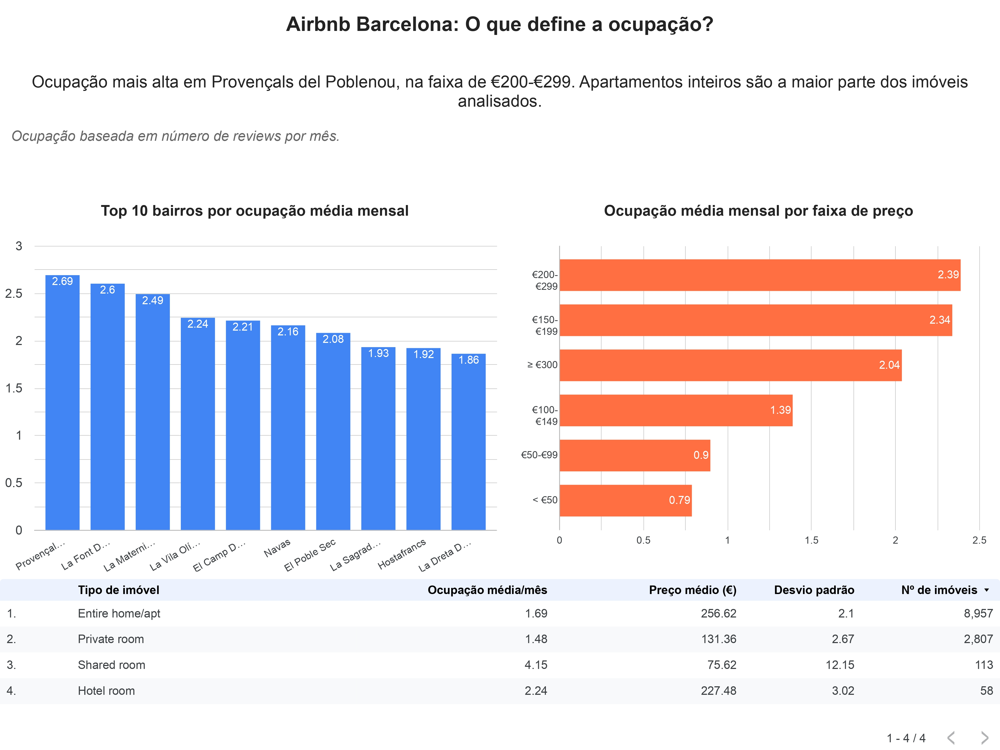

# Airbnb Barcelona: o que define a ocupação?

Análise de ocupação de imóveis do Airbnb em Barcelona, usando SQL (BigQuery) e Looker Studio.

**[Ver painel interativo](https://datastudio.google.com/s/kYeHE_Wvmzo)**

## Pergunta central

Quais características de um imóvel em Barcelona estão associadas a maior taxa de ocupação?

Três perguntas guiaram a análise:
1. Localização: a ocupação varia entre bairros?
2. Preço: existe uma faixa de preço com ocupação mais alta?
3. Tipo de imóvel: como se comparam apartamentos inteiros, quartos privados, quartos compartilhados e quartos de hotel?

## Dados

Inside Airbnb, Barcelona: https://insideairbnb.com/barcelona/
Arquivo usado: `listings.csv`, versão de 17/09/2026.

Inside Airbnb (Barcelona), com uma tabela:
- `listings`: características dos imóveis (bairro, tipo, preço, reviews por mês)

## Ferramentas

SQL (BigQuery) · Looker Studio · Excel (limpeza inicial)

## Métrica

A ocupação é estimada pela coluna `reviews_per_month`. Não é a taxa real de reservas: é uma aproximação baseada no número de avaliações.

## Decisões de limpeza

- Removi colunas de identificação do host, por privacidade.
- Padronizei os nomes dos bairros.
- Mantive imóveis com `price` ou `minimum_nights` em branco, cerca de 17% dos registros, porque excluí-los reduziria muito a amostra.
- Nas consultas, considerei apenas bairros, faixas e tipos com 10 ou mais imóveis.

## Principais resultados

1. A ocupação varia entre bairros?
  Sim. Provençals del Poblenou tem a maior ocupação média (2,69 reviews/mês) entre os bairros com 10 ou mais imóveis. 

2. Existe um preço que vende mais?
  O preço entre €200-€299 tem a maior ocupação média (2,39). As faixas mais baratas ficam abaixo de 1.

3. Qual tipo de imóvel tem melhor ocupação?
   Apartamentos inteiros concentram o maior volume, (8.957 imóveis) e ocupação média de 1,69 com desvio padrão baixo de 2,1.
   Quartos compartilhados têm a maior média, (4.15), mas são apenas 113 imóveis e o desvio é muito alto (12.15), tornando o resultado instável. 

Ressalva: o quarto compartilhado tem a maior média (4,15), mas apenas 113 imóveis, então o resultado é instável (desvio padrão 12,15).
